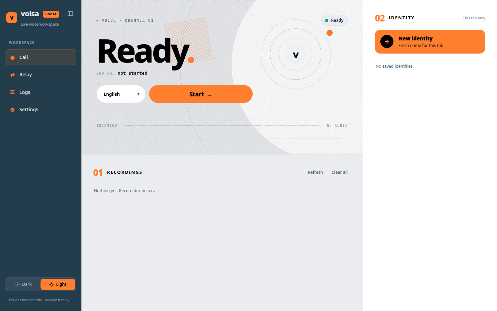
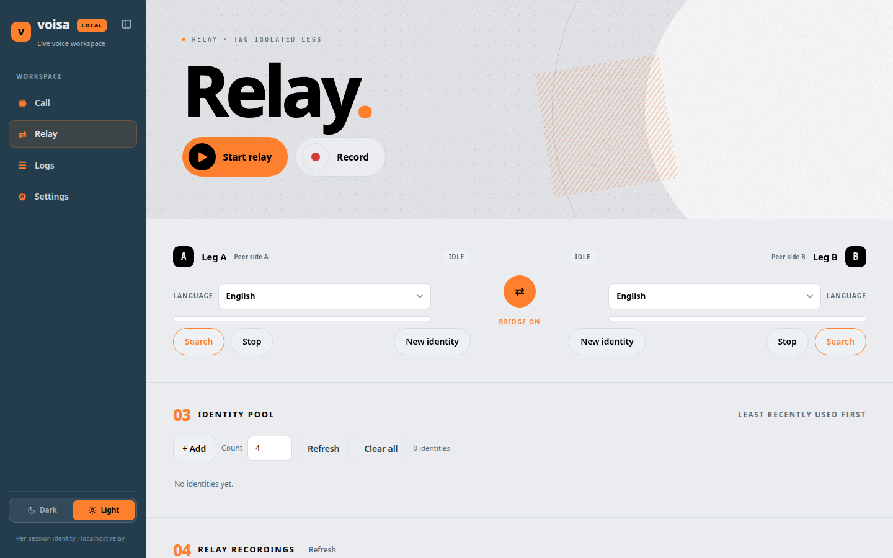
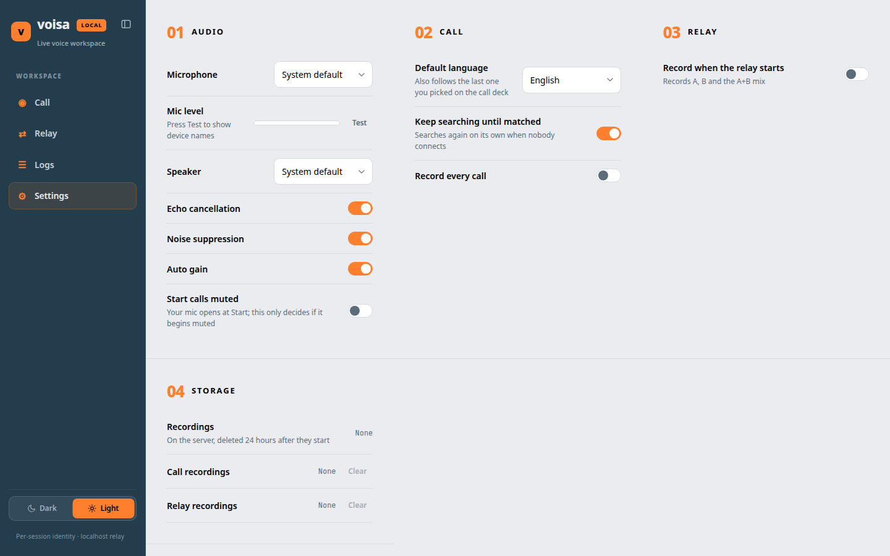
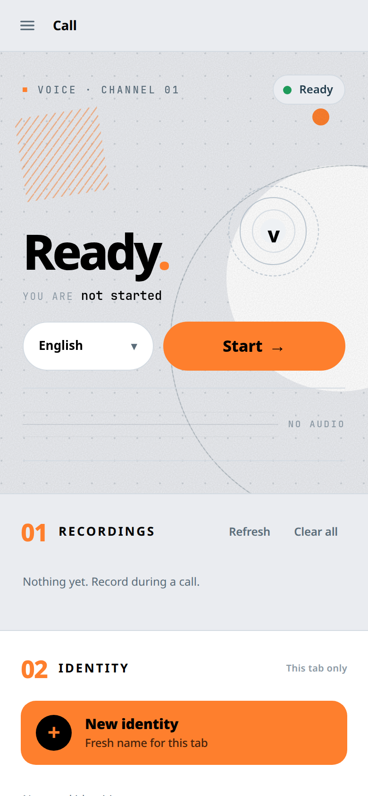

# Voisa

A self-hosted web client for Voisa random voice calls. One Go binary serves the
UI, a REST API and a WebSocket signalling channel. The browser is the WebRTC
peer, so audio never passes through the server.



## Features

- **Call**: pick a language, press Start, and you're matched with a stranger. The
  mic opens once per tab, and you can mute or unmute it during a call.
- **Relay (MITM)**: a man-in-the-middle bridge between two strangers. See
  [Relay = MITM](#relay--mitm).
- **Recordings**: call and relay recordings stream to the server in 1 s chunks.
  ffmpeg remuxes them on stop, and they're deleted 24 h after they start. A relay
  recording saves A, B and the A+B mix.
- **Identity**: a call identity lasts 24 h per browser. Every tab gets its own,
  and none is created until your first action.
- **Identity pool** for the relay legs, plus saved identities.
- **Per-user isolation**: an anonymous HttpOnly cookie (`voisa_uid`) keeps each
  browser's pool, saved identities, logs and recordings separate under
  `users/<id>/`.
- **Settings**: mic, speaker and level test, echo/noise/AGC, start muted, default
  language, keep searching, auto-record. Light theme by default, dark is one tap away.

| Relay | Settings |
|---|---|
|  |  |

<p align="center"></p>

## Relay = MITM

The Relay view is a man-in-the-middle.

```
stranger A  <── WebRTC ──>  leg A ┐
                                  ├─ your browser (bridge: A ⇄ B)
stranger B  <── WebRTC ──>  leg B ┘
```

1. **Start relay** starts two legs. Each leg mints a fresh identity
   (`/api/relay/fresh`) and opens its own upstream socket, then searches on its
   own and matches a random stranger.
2. Each stranger thinks they're in a normal 1:1 call with that leg's identity.
   Neither one knows about the other or about you.
3. With **Bridge** on, the browser feeds A's incoming audio into leg B's
   outgoing track and B's into A's. The strangers hear each other through you.
   The label says "Bridged" only once both legs are connected. Until then it
   shows "In call · waiting for A/B".
4. If a match dies, or doesn't connect within 15 s, the leg sends `next`. That
   closes the dialog and the leg requeues. The other leg keeps its stranger.
5. **Record** captures A, B and the A+B mix as one group.

Notes: a stranger hears silence while the other leg is still searching, so
many hang up within 5 to 15 s. The server only does signalling. All audio
routing happens in your browser's AudioContext.

## Requirements

- Go 1.26+
- ffmpeg (for the recordings)
- A reverse proxy with TLS (e.g. nginx). Browsers only allow the microphone on
  HTTPS or localhost.

## Build and run

```sh
go build -o bin/voisa ./cmd/voisa
./bin/voisa --root .            # http://127.0.0.1:8765
```

| Flag     | Default     | Meaning                                    |
|----------|-------------|--------------------------------------------|
| `--port` | `8765`      | listen port                                |
| `--root` | `.`         | project root, where `ui/` is read from     |
| `--data` | `--root`    | where `users/` and `voisa.log` are written |
| `--host` | `127.0.0.1` | localhost only, any other address is refused |

The server binds to localhost on purpose. Put nginx in front for TLS and
WebSocket upgrades:

```nginx
location / {
    proxy_pass http://127.0.0.1:8765;
    proxy_http_version 1.1;
    proxy_set_header Upgrade $http_upgrade;
    proxy_set_header Connection "upgrade";
    proxy_set_header Host $host;
}
```

### systemd

The service runs as its own system user, `voisa`, with no shell and no
home. It can write only its data directory, `/var/lib/voisa`. The code stays
root-owned, and the unit maps just `bin/` and `ui/` into the service,
read-only, so it can't see anything else on the host.

```sh
sudo useradd --system --no-create-home --shell /usr/sbin/nologin voisa
sudo systemctl enable --now voisa     # bin/voisa --root <app dir> --data /var/lib/voisa
sudo systemctl restart voisa          # after rebuilding the binary
```

UI-only changes (`ui/`) don't need a restart. A hard refresh is enough.

## Layout

```
cmd/voisa/        entry point (flags, localhost guard, graceful shutdown)
internal/
  server/         HTTP routes, /ws, call sessions, relay legs, recordings API
  sio/            minimal Socket.IO v4 client for the upstream
  account/        identity creation
  store/          identity pool and saved identities
  users/          anonymous per-browser owners
  recs/           server-side recordings and 24 h janitor
  logs/           voisa.log writer
ui/               index.html, css/ (numbered, cascade order matters), js/<area>/
users/            per-user data when --data is unset (gitignored)
```

See [ARCHITECTURE.md](ARCHITECTURE.md) for the full map.

## Notes

- There is no login. Anyone who can reach the URL can use it, so restrict access
  in nginx (basic auth, an IP allowlist) if the instance is public.
- Data files (`users/`, `voisa.log`, media) and `bin/` are gitignored.

## Disclaimer

This is an independent reverse-engineering and research project. It is not
affiliated with, endorsed by, or connected to Voisa or its developers. "Voisa"
and related names belong to their respective owners.

The repository contains only original code. No Voisa app code, APK or
decompiled sources are included. Using it may violate Voisa's terms of
service. The relay intercepts calls between people who don't know about it,
and recording or relaying someone's voice without their consent may be
illegal where you or they live. You are solely responsible for how you use
it. It is provided as is, without warranty.

## License

[MIT](LICENSE) © 2026 froyoandroid. The license covers this project's own
code only.
